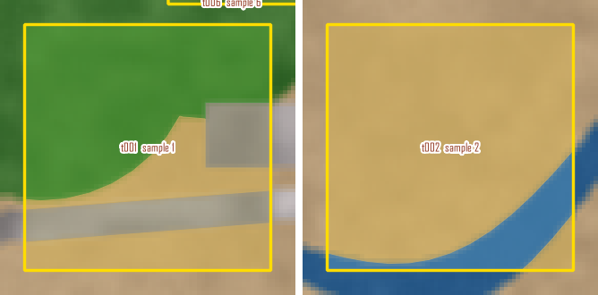
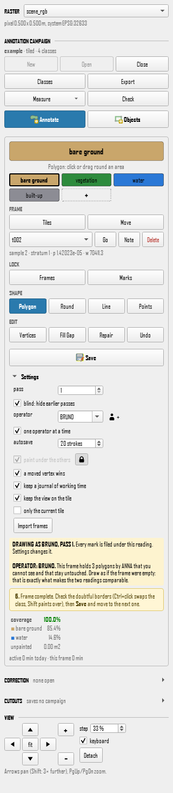
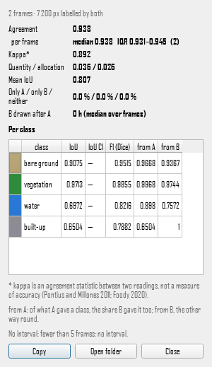
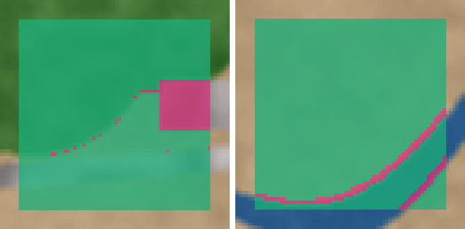
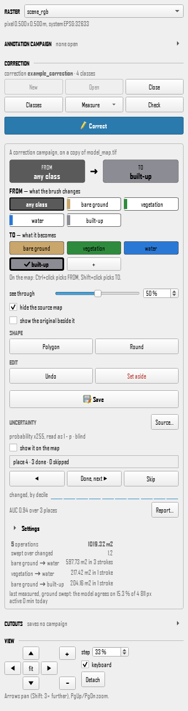

# RasterLabel tutorial: from a scene to a dataset, and back to a map

A walk through the program on a small example anybody can run: a synthetic
scene, the map an imaginary classifier made of it, and a sampling design.
Nothing in it is real data. You annotate frames with two readers, measure how
far they agree and how long it took, write the training data out, then correct
the classifier's map and measure how wrong it was.

Steps 1 to 7 are meant to take about ten minutes, drawing quickly; the rest is
another half hour. If you would rather watch it happen, step 17 runs every step
below without a window, in about ten seconds, and prints the numbers quoted
here.

Every button and menu label is written in bold type, exactly as the program shows
it. Every file the program writes is written in `code`, with the folder it goes
in. The numbers are those of the scripted run of step 17: drawn by your hand,
yours will differ a little, which is the point of measuring.

- [The example](#the-example)
- [1. Install the plugin](#1-install-the-plugin)
- [2. Open the scene](#2-open-the-scene)
- [3. New campaign](#3-new-campaign)
- [4. Import the frames of the sample design](#4-import-the-frames-of-the-sample-design)
- [5. Two readings of the same frames](#5-two-readings-of-the-same-frames)
- [6. Check](#6-check)
- [7. Compare two readings](#7-compare-two-readings)
- [8. Time](#8-time)
- [9. Export, with the dataset card](#9-export-with-the-dataset-card)
- [10. The whole raster, with the ignore value](#10-the-whole-raster-with-the-ignore-value)
- [11. Cutouts](#11-cutouts)
- [12. The same measure from Processing](#12-the-same-measure-from-processing)
- [13. Correct the model's map](#13-correct-the-models-map)
- [14. Model vs corrected](#14-model-vs-corrected)
- [15. Uncertainty](#15-uncertainty)
- [16. The dataset card of the correction](#16-the-dataset-card-of-the-correction)
- [17. The same walk, without a window](#17-the-same-walk-without-a-window)
- [Where everything was written](#where-everything-was-written)


## The example

`examples/rasterlabel_example/` in the repository, under 1.5 MB, made by
`tools/make_example.py` from a fixed seed (run it again and you get the same
bytes). Four files, and the legend:

| file | what it is |
|---|---|
| `scene_rgb.tif` | a picture of the scene: 600 x 400 pixels of half a metre, three bands, in UTM 33 N (EPSG:32633). A winding channel, three ponds, round shrubs, a patch of low vegetation, a track and a few roofs, on bare ground |
| `model_map.tif` | the map of an imaginary classifier on the same grid. Band 1 is the class, 1 to 4; band 2 is `probability x255`, the probability it gave to that class. The map is wrong on about 5 % of the pixels, and less sure where it is wrong. Its colours and class names sit beside it, in `model_map.tif.aux.xml` and `model_map.qml` |
| `sample_design.gpkg` | twelve points drawn as AcATaMa draws a stratified random sample, three in each class of the map: `sample_id`, `stratum`, `incl_prob`, `weight`, `design` |
| `classes.csv` | the four classes: 1 bare ground, 2 vegetation, 3 water, 4 built-up, with their colours |

The Classes window of the program does not read a file, so `classes.csv` is
what you type from, in step 3.



The picture above is frames `t001` and `t002` of step 4, drawn by the first
reader (the script of step 17), over the scene.


## 1. Install the plugin

Download `rasterlabel-1.1.zip` from the release page of the repository, then in
QGIS: **Plugins ▸ Manage and Install Plugins ▸ Install from ZIP**, choose the
file and press **Install Plugin**. RasterLabel appears under **Raster ▸
RasterLabel** and on the toolbar. To make the zip yourself:
`python tools/package_plugin.py`, which writes `dist/rasterlabel-1.1.zip`.

(The other way in is two lines in the Python Console; the README has them.)

Writes: the plugin folder of your QGIS profile. Nothing else.


## 2. Open the scene

**Layer ▸ Add Layer ▸ Add Raster Layer**, and choose `scene_rgb.tif` of the
example folder. QGIS draws the picture; the **RASTER** box at the top of the
RasterLabel panel lists it, and under it the panel says `pixel 0.500 x 0.500
m, system EPSG:32633`.

Writes: nothing.


## 3. New campaign

In the block **ANNOTATION CAMPAIGN**, press **New**. In the window:

- **Name**: `example`. **Operator**: `ANNA` (kept in capitals).
- **Folder**: where the campaign goes, for instance a folder `campaign` beside
  the example. Type it: the window follows the name until you do.
- **Reference raster**: `scene_rgb`. The window says `600 x 400 pixels, small
  enough to work in one go, so free is proposed below`. Under **How this
  campaign is annotated** choose **In tiles** all the same: the sample design
  of the next step needs frames.
- **Classes…** opens the **Classes** window. The first row is `class 1`: type
  `bare ground` over its name. Press **Add class** three times and name the
  rows `vegetation`, `water` and `built-up`. For each class press its colour
  swatch and write the colour of `classes.csv` in the colour window (HTML
  notation: `#c9a66b`, `#2e8b3d`, `#2a78d6`, `#8c8c94`). Their numbers, 1 to
  4, are given in order, the same as the codes of `model_map.tif`. **Ok**.
- **Ok** again. The window says `4 classes: bare ground, vegetation, water,
  built-up`.



Writes, in the campaign folder:

- `campaign.json`, the manifest: the name, the grid of the scene (origin, pixel
  size, system, size) frozen at its first line, the classes and their codes;
- `annotation.gpkg`, the GeoPackage with the tables `tiles`, `polygons`,
  `lines`, `points` and `boxes`, empty.

The scene is not touched.


## 4. Import the frames of the sample design

Press **Annotate**, then **Tiles** under FRAME. Taking the Tiles tool opens
**Settings** by itself and shows the row **tile side**, which is hidden while
another tool is in hand; the box starts at 200 pixels, 100 m on this scene.
Set **tile side** to `30` m: a frame is 60 pixels, 0.09 hectare. Then press
**Import frames** at the end of the settings. (You place no frame by hand
here: the tool is only held so that its setting is on view.)

In the file window **Frames to import** choose `sample_design.gpkg`. The
**Import frames** window says what it found and what it will do:

- **From**: `sample_design.gpkg`, 12 points, EPSG:32633.
- **The design**: the five columns are guessed, each by name: `sample_id`,
  `stratum`, `incl_prob`, `weight`, `design`. Every value is carried exactly as
  given: no weight is worked out from a probability, and nothing is
  normalised.
- **Frame side**: `Settings: 30.00 m (60 px)`.
- **What will happen**: `12 added: 0 moved onto the grid, 0 resized, 12 from
  points`.

Press **Import**. The box says `12 frames added, 0 already there, 0 refused`.
Twelve frames, `t001` to `t012`, are on the map, none over another; the list
under **FRAME** holds them, and under it a quiet line gives the design of the
frame in hand: `sample 1 · stratum 2 · p 0.000227393 · w 4397.67`.

Writes:

- twelve rows in the `tiles` table of `annotation.gpkg`, each with its
  `sample_id`, `stratum`, `incl_prob`, `weight` and `design`;
- `design_log.csv` in the campaign folder: one row for each of the twelve
  points of the file, what became of it and why;
- a `designs` entry in `campaign.json` with the mapping that was chosen.

Frames may touch but never overlap; a point whose frame would lie over another
frame, or off the scene, is refused and said, and still gets its row in the log.


## 5. Two readings of the same frames

A reading is one operator in one pass: `ANNA, pass 1`. Two readings of the same
frames are what agreement is measured on, and they are comparable only if
neither was drawn with the other in front of it.

The first reading, ANNA, pass 1. Under **Settings** the **operator** is `ANNA`
and the **pass** is 1. In the list under **FRAME** choose `t001`. Draw the small sharp things
first, the background last:

1. choose a class chip, for instance `vegetation`;
2. take **Polygon** (the caption under the class reads `Polygon: click or drag
   round an area`) or **Round**, and go round the shrubs, the patch of low
   vegetation, the roof, the track, the pond or the channel in the frame; a new
   mark yields to the ground already claimed, so you can overshoot;
3. choose `bare ground` and press **Fill Gap**: what is not painted yet takes
   the class in hand. The line under **coverage** reads `100.0%`;
4. **Save**.

Do the same in `t002`. `t001` holds the patch of low vegetation, a stretch of
track and a roof; `t002` the channel.

The second reading, BRUNO, pass 1, blind. In **Settings** write `BRUNO` in the
**operator** box and press the **+** beside it, which writes the name into the
campaign. The pass stays 1. **one operator at a time** is ticked, as it is when a campaign is
made: BRUNO opens `t001` and sees it empty. The amber note says so
(in `t002`): `This tile holds 3 polygons by ANNA that you cannot see and that
stay untouched.` Draw
`t001` and `t002` as above, and **Save**. That is what makes the two readings
comparable. (**blind: show only this pass** is the same idea for a second pass of
the same person: add pass 2 with the **+** beside **pass**, and pass 1 is
hidden while you draw it, as pass 2 is hidden when you go back to pass 1.)

If you also want the journal of step 8 to hold real times, leave **keep a
journal of working time** ticked, as it is.

Writes: `polygons` rows in `annotation.gpkg`, each with its class, its frame,
its operator and its pass. In the scripted run ANNA's reading is 8 polygons
and BRUNO's 7, whose roof is missing and whose outlines are a pixel or two
off; yours are your own. `journal.csv` starts in the campaign folder at the
first frame, and `campaign.json` gets its `journal` block. A safety
copy of the work not yet saved is kept in `recovery/`.


## 6. Check

Press **Check**. A window titled `RasterLabel: Check` says which QGIS, Qt, GDAL and
numpy are running, and whether the campaign still agrees with itself: the
manifest and the package, the frames and their design, the journal. It heads
the report with `Everything checks out` or `Nothing is broken` and says
what is worth knowing. **Copy report** puts it in the clipboard for a bug
report. Nothing is changed and nothing is written.


## 7. Compare two readings

Before anything is shown to the person who drew, the program asks who is
looking. BRUNO is drawing with **one operator at a time** on, so pressing
**Measure ▸ Compare two readings…** now is refused, in these words:

> BRUNO is drawing pass 1 with one operator at a time on, so ANNA, pass 1 is
> hidden from BRUNO. The agreement map would show it. Untick 'one operator at a
> time' under Annotate's Settings, or change who is drawing to the reading whose
> work this is, then compare.

Untick it, then press **Measure**, and in its menu **Compare two readings…**.

In the window **Compare two readings**:

- **Which readings**: **Kind** `Two operators, one pass (inter-observer)`,
  **A** `ANNA, pass 1`, **B** `BRUNO, pass 1`.
- **Which frames**: **closed by both readings** `(2)`. A frame is closed when one
  reading paints more than 99.5 % of its area. The other choice,
  **touched by both readings**, takes every frame both drew in.
- **What counts**: **the points, as in the mask**, off.
- **Uncertainty**: **Resamples** `2000`, **Seed** `1`. The bootstrap draws
  whole frames, never pixels, and gives no interval from fewer than five.
- **Where**: **Folder**, `reports/agreement/ANNA_p1_vs_BRUNO_p1_<date-time>` in the
  campaign, and **put the maps in QGIS**, ticked.

Press **Compare**. A window reports the headline numbers, a table per class,
and the footnotes.



In the scripted run: 2 frames, 7 200 pixels labelled by both. Agreement 0.938;
kappa 0.892, written as an agreement statistic between two readings and not as
accuracy; quantity disagreement 0.036 and allocation disagreement 0.026; mean
IoU 0.807. Per class IoU: bare ground 0.908, vegetation 0.971, water 0.697,
built-up 0.650: the roof BRUNO left out and the edge of the channel are where
the two disagree. There is no interval, with two frames.

In QGIS the group of the campaign gets a subgroup `agreement ANNA p1 vs BRUNO p1`
with the disagreement map: green where the readings agree, pink where they
differ, blue where only A painted, amber where only B did.



Writes, in `reports/agreement/ANNA_p1_vs_BRUNO_p1_<date-time>/` of the
campaign, and nothing in the campaign itself but its list of reports
(`reports` in `campaign.json`):

- `summary.json`: the version, the build, the inputs with their SHA-256, the
  parameters (seed, resamples, frame rule), the headline numbers and the notes;
- `confusion.csv`, `confusion_by_frame.csv`, `per_class.csv`, `per_frame.csv`,
  `pairs.csv`: the tables, with `sample_id`, `stratum`, `incl_prob` and
  `weight` appended to the per frame table, so a weighted estimate can be made
  in R;
- `example_agreement_ANNA_p1_vs_BRUNO_p1_disagreement.tif` and
  `..._pairs.tif`, with their `.qml` styles, and
  `example_agreement_ANNA_p1_vs_BRUNO_p1.gpkg` of the places where they
  differ.

Written under a name ending `.tmp` and renamed when whole, so a report is never
half written, and never over an older one.


## 8. Time

**Measure ▸ Time…** is grey until the journal has begun, and says so if it is
off. In the window **Time**:

- **Drawn from scratch**: tick `ANNA, pass 1` and `BRUNO, pass 1`, with the
  frames each drew.
- **Corrected**: `none` for now. Step 13 gives it a correction to set against.
- **Which frames**: `every frame read`, `closed only` or `drawn and corrected`.
- **What counts**: **Idle after** `60 s`: a pause longer than that, between two
  things done or inside a stroke, is not work. 30, 60 and 120 s are all
  written.
- **Where**: **Folder** and **put the maps in QGIS**. Press **Write**.

The window gives the active time, and the minutes per hectare drawn. In the
scripted run the strokes are made by a program, so it reports half a second:
the numbers of a real afternoon are worth reading, these are not.

Writes, in `reports/time/<date-time>/`: `time_summary.json`,
`time_per_frame.csv`, `time_per_class.csv`, `time_frames.gpkg` and its
`time_frames.qml`; the working time of each frame is also a layer in QGIS.
The journal it reads, `journal.csv`, is kept in the campaign folder and
only ever appended to.


## 9. Export, with the dataset card

Press **Export**. In the window `RasterLabel: Export`:

- **What to write**: the tables with their row counts, and
  **dataset card (Markdown + JSON)**, ticked (it is ticked to begin with, and
  remembered once you change it).
- **Which reading**: leave `all readings together`, which writes every reading's
  drawing, each row carrying its operator and pass. The other choices are `ANNA,
  pass 1`, `BRUNO, pass 1` and their consensus; with one of them the tables are
  named after it (`example_ANNA_p1.gpkg`), while the card keeps the name of the
  campaign (`example_card.md`).
- **In what shape**: `GeoPackage: every table in one file`; shapefile, GeoJSON,
  KML and CSV are there too.
- **Where**: **Folder**, `export` in the campaign by default.

Writes, in the folder: `example.gpkg`, `example_card.md` and `example_card.json`.
The card says, for a reader who has not seen the campaign: the grid and the
system, the classes and how many pixels each holds in every reading and in
their consensus, the frames and which are closed (with the design columns they
carry, listed as found, not interpreted), who drew what, the rules that made
the pixels (pixel centre, last drawn wins, the unlabelled and reserved values),
the measures made so far, the build of RasterLabel and the SHA-256 of every
file written. It changes nothing in the campaign.

The same card, for the campaign as it stands, is **Measure ▸ Dataset card…**:
it goes in `reports/card/<date-time>/` as `example_card.md` and
`example_card.json`, and the box says `2 readings, 1 consensus, 12 frames
(2 closed)`. A campaign card is refused, like Compare, while the filter hides
a reading from the person drawing.


## 10. The whole raster, with the ignore value

The mask of a reading, one band of class codes on the grid of the scene, is
written from the block **CUTOUTS**: press **Cutouts**, then **Whole**. In
**Whole raster**:

- **Raster**: `scene_rgb`.
- **What to write**: untick **the image with the annotation on it** (ticked to
  begin with), leave **the mask of class codes** ticked, and tick **the dataset
  card, with the pixel counts of this mask** (unticked to begin with, because
  it counts every reading and takes a while on a large campaign).
- **Which reading**: **Readings**, `ANNA, pass 1`.
- **Where nobody painted**: **Pixels** has three choices. `0, as before` writes 0
  where nobody painted; a training script that skips unlabelled pixels has to be
  told that 0 is one, and a frame nobody painted holds 0 too, as "none of
  these". `the ignore value everywhere` writes the **Ignore value**, `255` by
  default, and declares it as the nodata of the mask. `0 in the frames, the ignore
  value outside` is for a campaign whose frames are all closed: inside a frame,
  ground nobody painted is 0, a class meaning none of these, and outside every
  frame, where nobody looked, it is 255. Ten of the twelve frames here are not
  drawn, so choose `the ignore value everywhere`. The line under it says what the
  mask will hold. The values 0 and the class codes are refused as ignore values.
- **How** (**Format**, **Scale**, **Paint**), **Drawn on it** and **Where**
  (**Folder**): leave them.

Writes, in the folder:

- `example_scene_rgb_ANNA_p1_ign255_mask.tif`: 600 x 400, Byte, nodata 255.
  In the scripted run 7 200 pixels are classes (4 151 bare ground, 1 870
  vegetation, 441 water, 738 built-up), the two frames of ANNA, and
  232 800 are 255. None is 0;
- `example_scene_rgb_ANNA_p1_ign255_card.md` and `.json`: the card, with the
  pixel counts of this mask and whether the mask holds them;
- `example_scene_rgb_ANNA_p1_ign255_mask.stac.json`, a STAC item, because the
  scene has a coordinate system;
- beside the mask, `example_scene_rgb_ANNA_p1_ign255_mask.qml`, its style for
  QGIS, and `example_scene_rgb_ANNA_p1_ign255_mask.tif.aux.xml`, the statistics
  GDAL keeps for it. Nothing else: with the painted image left ticked there
  would be a picture of the scene with the annotation on it as well.

The name says the reading and the ignore value, so a mask written another way
never replaces this one.


## 11. Cutouts

Cutouts cut the same window out of several layers, on one pixel grid, to make
training tiles. The truth of a cutout is a layer, so add the mask to QGIS first:
**Layer ▸ Add Layer ▸ Add Raster Layer**, `example_scene_rgb_ANNA_p1_ign255_mask.tif`.
In the block **CUTOUTS**, with **Cutouts** open:

- **Layers** opens **Layers to cut**. In its **cut as** column set `scene_rgb` to
  `image`, the mask to `classes`, and every other layer to `ignore`. **Pixel grid from**
  `scene_rgb`. **Ok**.
- Open **Settings**: **side** `30` m, **folder** where the dataset goes,
  **unlabelled as ignore** ticked with `255` (the 0 of a mask written without an
  ignore value, and the padding at an edge, become the ignore value; a mask
  that carries its own keeps it), **STAC catalogue** ticked. **boxes for
  detection** is ticked to begin with and writes nothing here: the example has
  no box (see [Boxes for detection](../README.md#boxes-for-detection)).
- **Cut** and click the middle of `t001`, then of `t002`: a square of the side
  asked is cut out of every layer. **All tiles** does it for every frame of the
  campaign at once, the ten you did not draw included, whose masks come out all
  255: a reason to cut the frames you drew.

Writes, in the folder, for each cutout (`cut_0001`, `cut_0002`) one file a layer,
named after the layer and the role it was cut as: `cut_0001_scene_rgb_image.tif`
and `.png`, and `cut_0001_<name of the mask layer>_classes.tif` and `.png`, 60 x
60 pixels each. And in the folder: `cutouts.csv` (one row a file, with the
frame, the grid and `ignore_index`, 255 for the mask), `cutouts.gpkg` (the
footprints), `sampler.json`, `layers.json` (the layers it was cut from, by their
way from the folder), `shapes.json` and `stac/` (`catalog.json` and one item per
cutout). **Undo** deletes the last cutout from the disk, and
**Folder** opens the folder.


## 12. The same measure from Processing

Step 7 is also an algorithm of the Processing toolbox, for Model Designer, batch
runs and scripts. In the **Processing Toolbox ▸ RasterLabel** it is **Agreement
between two readings**. In the Python Console:

```python
import processing

out = processing.run("rasterlabel:agreement", {
    "CAMPAIGN": "/path/to/campaign/campaign.json",
    "READING_A": "ANNA,1",
    "READING_B": "BRUNO,1",
    "FRAMES": 0,                 # 0 closed by both, 1 touched by both
    "POINTS_IN": False,
    "RESAMPLES": 2000,
    "SEED": 1,
    "ALLOW_UNFINISHED": False,   # an unfinished reading is refused, by name
    "OUTPUT_FOLDER": "/path/to/agreement_report",
})
print(out["OVERALL"], out["KAPPA"], out["FRAMES_USED"])
```

It prints `0.9379166666666666 0.8923429239138698 2`, the numbers of step 7,
because it is the same engine with the same seed. Beside them come `QUANTITY`,
`ALLOCATION`, `MEAN_IOU`, the maps (`DISAGREEMENT`, `PAIRS`), the GeoPackage
(`VECTORS`) and `SUMMARY`, the path of `summary.json`. Left empty,
`OUTPUT_FOLDER` is `reports/agreement/` of the campaign. `CAMPAIGN` is the
campaign's folder or its `campaign.json`, as in the other four algorithms. The
campaign is only read: the manifest and the package are not written. A reader the panel has
blinded to one of the readings is refused, with the panel's own words.

The other measures are in the same group, **Measure**, under **RasterLabel**
in the toolbox: `rasterlabel:model_vs_corrected`, `rasterlabel:time_report`,
`rasterlabel:uncertainty_report` and `rasterlabel:dataset_card`. Each only
reads the campaign or the correction and writes a new report folder, and
each says in its help what it reads and what it writes.


## 13. Correct the model's map

Close the campaign (**Close**) if you like: Correct needs none. Add
`model_map.tif` to QGIS; it opens with its four classes, from `model_map.qml`.

In the block **CORRECTION** press **New**. In **New correction**:

- **Correction**: `+ new correction campaign`.
- **Name**: `example correction`. **Thematic map**: `model_map   [2 bands]`.
  **Class band**: `band 1` (named `class`); band 2 is the probability.
- **Folder**: a new one, for instance `correction`. **Operator**: `ANNA`. **Ok**.

The window **Classes of the map** shows the classes read from the map: from
its style where it names them, from its colour table, or from the values
themselves. Here they are the names and colours of its category table,
`bare ground`, `vegetation`, `water`, `built-up`, with the number of pixels of
each. Look them over, change what is wrong, and press **Ok**. The correction never touches the map it started from: it copies
it once into the folder, band for band, and works on the copy.

Correct is open already: **New** opens the new correction in it, and the
**Correct** button shows pressed. (Pressing it again closes the module and the
correction, as **Close** does; if that happens, **Open** under CORRECTION
brings the correction back.) The panel shows **FROM**, what the brush changes (`any class`,
or one), and **TO**, what it becomes, as chips. Pick them, take **Polygon** or
**Round**, and draw; Ctrl+click on the map picks FROM and Shift+click picks TO.
The errors of the map are easy to see against the scene. Here are five of them
(E and N in metres, UTM 33 N):

| where | the map says | it is |
|---|---|---|
| the west half of the round pond, around E 500224, N 4200144 | vegetation | water |
| the stretch of channel at E 500055 to 500092, N 4200084 to 4200126 (it climbs across the stretch) | bare ground | water |
| the stretch of channel at E 500192 to 500220, N 4200085 to 4200093 | bare ground | water |
| the oblong pond, E 500169, N 4200042 | bare ground | water |
| the roof, E 500202 to 500219, N 4200044 to 4200056 | bare ground | built-up |

For each, choose FROM and TO as in the table and draw a polygon round it.
**Undo** takes the last change back (its row stays in the log), and **Save**
flushes the copy to disk. There are more errors in the map than these five:
the roofs and the stretches of track it missed, a quarry floor taken for
built-up, a patch of low vegetation taken for ground. Step 15 finds them for
you.



Writes, in the correction folder:

- `correction.json`: the manifest, with the source map, the band, the
  classes as confirmed and the count of operations;
- `model_map_corrected.tif`, the working copy, with its `.qml` and
  `.aux.xml` (the classes, so any program draws it in them), and
  `model_map_corrected_changes.tif`, the record of the pixels a person changed;
- `operations.csv`, one row a stroke (14 columns): when, who, from which class
  into which, how many pixels, the ground swept and the ground changed. The
  scripted run's five strokes changed 4 074 pixels, 1.7 % of the map. (The
  generator knows the truth the scene was drawn from, `scene_truth()` in
  `tools/make_example.py`: against it the map had 12 903 wrong pixels, and has
  9 277 after the strokes.);
- `journal.csv` and `rasterlabel.log`.

`model_map.tif` and the files beside it are as they were, byte for byte.


## 14. Model vs corrected

In the **CORRECTION** block press **Measure**; its menu has **Model vs
corrected…**, **Uncertainty report…**, **Time…** and **Dataset card…**.
**Model vs corrected…** compares the map the model made with the map as
corrected, pixel by pixel, the corrected map being the reference. In the window:

- **Which ground**: **the whole map**, **the ground the strokes swept** or
  **inside the polygons of a layer**. Each says how it is biased. Over the whole
  map, ground nobody looked at counts as right, so the model's agreement is an
  upper bound; over the ground the strokes swept, chosen where the model
  was wrong, it is a lower bound; inside the polygons of a layer of the
  project (frames you reviewed whole, a sample drawn at random) it is the
  agreement over those polygons, with a bootstrap interval over them.
- **Beside it: people against people**: `nobody`, or another person's correction
  of the same map, or the agreement report of step 7.
- **What to write**: the tables, and **the map of what changed, styled for
  QGIS**. **Where**: **Folder** and **put the map in QGIS**.

Press **Compare**. In the scripted run, over the whole map: 240 000 pixels, the
model agrees on 98.3 %, all of it quantity disagreement (1.7 %), mean IoU 0.884.
Over the ground the five strokes swept, 4 811 pixels, it agrees on 15.3 %: the
strokes were made where it was wrong. Both are true, and neither is the model's
accuracy: one is an upper bound and the other a lower one, and the program says
so beside each. Reviewing whole frames drawn at random, which is what the
sampling design of this example is for, and choosing the third ground, is how
to get a number that is not a bound.

Writes, in `reports/model_vs_corrected/whole_<date-time>/` (or `swept_...`) of
the correction: `summary.json`, `confusion.csv`, `per_class.csv` (producer's and
user's accuracy, omission, commission, IoU, F1, quantity and allocation),
`pairs.csv`, and the map of pairs `model_map_corrected_mvc_whole_pairs.tif`
with its `.qml`. `model_map_corrected_reviewed.tif` beside the copy records which
pixels a stroke covered. A quiet line under the tally of Correct says the last
measure.


## 15. Uncertainty

The map came with a second band, the probability of the class. Correct can use
it to send you first to where the model was unsure, and to measure how often a
person changed the class there. RasterLabel runs no model; it reads the number
the model left.

Under **Save**, the card **UNCERTAINTY** says `band 2 "probability x255" looks
like the probability of the class.` Press **Use it**. The band is read once, as
1 - p, into `model_map_corrected_uncertainty.tif`; the line reads
`probability x255, read as 1 - p · blind`. **Source…** is where you choose
another band or raster, what it holds (a probability, an entropy, a margin, a
ready-made uncertainty, the votes of a consensus), its scale, and the **side**
of a place, 256 pixels by default.

The map is cut into places of that side, and they are ranked by their mean
uncertainty: here, six. Press **Start ▶**: the view goes to the first one. Look
at every pixel of it, mend what is wrong, then **Done, next ▶**; **Skip** passes
a place you did not review, and **◀** looks back without marking anything.
**show it on the map** draws the uncertainty over the classes, multiplied in, so
they darken where the model was unsure. One place in five (**1 in** `5`) is
drawn at random instead, as a simple random sample, and only those places carry
an inclusion probability. **blind: hide the uncertainty while reviewing**, on by
default, keeps the uncertainty and the reason a place was chosen out of the card
while places remain, so that it does not steer your hand.

When you have done some places, press **Report…** on the card, or **Measure ▸
Uncertainty report…**. In the scripted run three places were done, and the
whole-map AUC of the uncertainty against the pixels changed is 0.90: the
pixels the person changed were mostly the ones the model had least confidence
in. No random place was reached, so the random-places numbers are empty, and
the report says so.

Writes, beside the copy: `model_map_corrected_uncertainty.tif` (one byte a
pixel, 0 to 254 for u from 0 to 1, 255 for no value), `uncertainty_places.csv`
and `uncertainty_places.geojson`. The report goes in
`reports/uncertainty/<date-time>/`: `summary.json`, `calibration.csv` (the
share changed by decile of u), `capture.csv` (how much of the change the most
uncertain 1, 2, 5, 10, 20, 30, 50 and 100 % of the map hold), `places.csv`,
`strokes.csv` and `calibration.png`.


## 16. The dataset card of the correction

**Measure ▸ Dataset card…** in the correction's menu counts the copy as
step 9's counts the campaign: the classes and their pixels before and after,
which class became which, the operations, the bands of the map, the measures
made so far, and the SHA-256 of the copy and of the record of changes. It goes in
`reports/card/<date-time>/` of the correction as `example_correction_card.md`
and `example_correction_card.json`.


## 17. The same walk, without a window

`tools/tutorial_walk.py` does every step above through the panel, with the
windows that ask answered by the script, on a copy of the example in a scratch
folder, and prints the numbers quoted here. Run it with the Python of a QGIS:

```
QT_QPA_PLATFORM=offscreen python tools/tutorial_walk.py
```

On Windows that is the `python-qgis.bat` of the QGIS folder, and the same line
with `set QT_QPA_PLATFORM=offscreen` before it. `--figures docs/img` also
renders the pictures of this page, and `--keep some/folder` keeps what it wrote.
The suite `tests/test_tutorial_walk.py` runs it, so a button that is renamed or
a window that changes its way breaks the suite and not, silently, this page;
`tests/test_tutorial_text.py` checks that every label in bold here is a label
of the program.

To make the example again, `python tools/make_example.py` (or with a folder as
an argument): the generator needs numpy and the GDAL bindings, and writes the
same six files each time.


## Where everything was written

```
example/                      the example, as it came (never written to)
  scene_rgb.tif  model_map.tif  model_map.tif.aux.xml  model_map.qml
  sample_design.gpkg  classes.csv

campaign/                     step 3
  campaign.json  annotation.gpkg              the manifest and the package
  design_log.csv                              step 4, one row a point
  journal.csv                                 step 5 on, append only
  recovery/                                   until what is in it is saved
  reports/
    agreement/ANNA_p1_vs_BRUNO_p1_<stamp>/    step 7
    time/<stamp>/                             step 8
    card/<stamp>/                             step 9

export/                       step 9: example.gpkg, example_card.md, .json
whole/                        step 10: the mask, its card, its STAC item
cutouts/                      step 11: the tiles, cutouts.csv, stac/

correction/                   step 13
  correction.json  model_map_corrected.tif  ..._changes.tif  operations.csv
  model_map_corrected_reviewed.tif            step 14, the pixels a stroke covered
  model_map_corrected_uncertainty.tif         step 15, with the places
  journal.csv
  reports/
    model_vs_corrected/<scope>_<stamp>/       step 14
    uncertainty/<stamp>/                      step 15
    card/<stamp>/                             step 16
```

Every report goes in a folder of its own, written under a name ending `.tmp`
and renamed when it is whole, never over an older one. A report carries the
version and build of RasterLabel, the SHA-256 of what it read, and the seed of
every resampling, so it can be repeated.
